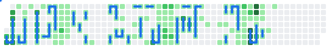

  <picture>
    <source media="(prefers-color-scheme: dark)" srcset="https://readme-typing-svg.demolab.com?font=Fira+Code&weight=600&size=28&duration=3000&pause=700&color=58A6FF&center=true&vCenter=true&width=600&height=50&lines=Sakamura;Discord+Bots+%26+Web+Apps;TypeScript+%C2%B7+Python+%C2%B7+Kotlin">
    
  </picture>

  
  
  
  

---

## About

Discord bot developer and web builder. I ship small, fast, self-contained things — VTuber fan sites, campus tools, laundry panels. TypeScript first, Python when the bot needs it, Kotlin on the learning pile. Part of **[The Onheil Foundation](https://github.com/Sakamuraa)**.

---

## Tech Stack

  

---

## Featured Projects

<table>
  <tr>
    <td width="50%">
      <h3 align="center">sakukampus</h3>
      

        
         Katalog beasiswa + eligibility checker per golongan UKT per kampus
      

    </td>
    <td width="50%">
      <h3 align="center">vtube-info</h3>
      

        
         An independent index of VTuber channels
      

    </td>
  </tr>
</table>

---

## GitHub Analytics

  <picture>
    <source media="(prefers-color-scheme: dark)" srcset="https://github-profile-summary-cards.vercel.app/api/cards/profile-details?username=Sakamuraa&theme=github_dark">
    
  </picture>

  <picture>
    <source media="(prefers-color-scheme: dark)" srcset="https://github-profile-summary-cards.vercel.app/api/cards/repos-per-language?username=Sakamuraa&theme=github_dark">
    
  </picture>
  <picture>
    <source media="(prefers-color-scheme: dark)" srcset="https://github-profile-summary-cards.vercel.app/api/cards/most-commit-language?username=Sakamuraa&theme=github_dark">
    
  </picture>

  <picture>
    <source media="(prefers-color-scheme: dark)" srcset="https://streak-stats.demolab.com?user=Sakamuraa&theme=dark&background=0d1117&border=30363d&stroke=30363d&ring=58a6ff&fire=58a6ff&currStreakNum=c9d1d9&sideNums=8b949e&hide_border=true&border_radius=6">
    
  </picture>

---

  <picture>
    <source media="(prefers-color-scheme: dark)" srcset="https://raw.githubusercontent.com/Sakamuraa/Sakamuraa/main/assets/snake-dark.svg">
    
  </picture>

  <code>npm run build</code> · <code>git push --force-with-lease</code> · <code>defer close()</code>

